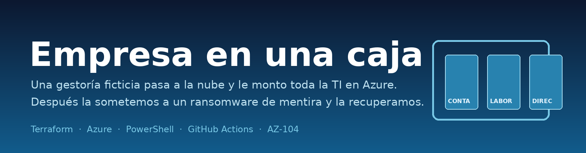
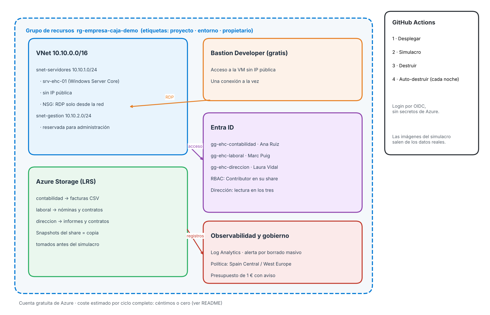
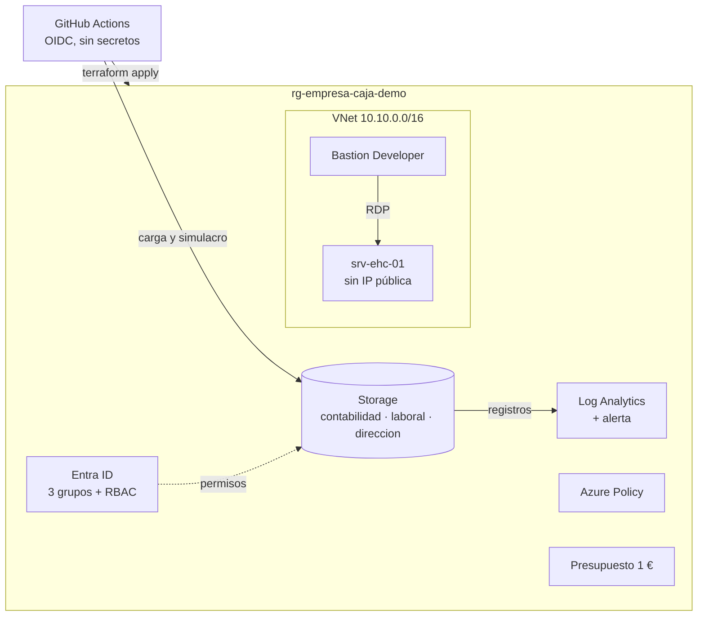

<p align="center">
  
</p>

# Empresa en una caja

Monto la infraestructura de una gestoría ficticia en Azure con un comando y después simulo un ransomware para ver cuánto tardo en recuperarla.

## Recuperé la empresa en **X minutos**

<!-- Sustituir X por el valor de recuperacion_minutos de resultados/simulacro.json tras el primer simulacro -->


## Qué es

Imagina una gestoría de 15 personas. Hasta ahora tienen sus facturas, nóminas y contratos en un ordenador de la oficina. Este proyecto mueve esa infraestructura a la nube: un servidor, una carpeta compartida por departamento, usuarios con permisos distintos y copias de seguridad.

Luego viene lo importante. Un ransomware secuestra los archivos y pide dinero. Aquí simulo ese ataque, pero sobre documentos falsos y de forma inofensiva: renombro los archivos, sobrescribo su contenido y dejo un mensaje de broma. Después los recupero desde la copia y compruebo, archivo a archivo, que son idénticos a los originales. Todo se mide, y el resultado sale en la página.

## Simulacro

<p align="center">
  
</p>

<p align="center">
  
</p>

<p align="center">
  
</p>

Las tres imágenes salen de `resultados/simulacro.json`, que escribe el propio workflow. No están dibujadas a mano.

## Arquitectura

<p align="center">
  
</p>



| Servicio | Para qué | Por qué este y no otro |
|---|---|---|
| Virtual Network + NSG | Aislar la VM y cerrar la entrada desde Internet | Sin IP pública no hay superficie de ataque directa |
| Azure Bastion (Developer) | Entrar por RDP sin IP pública | Es gratis en la modalidad Developer. La Standard cuesta por hora |
| VM Windows Server Core (B1s) | El "servidor" de la gestoría | Es de las VM incluidas en la cuenta gratuita y Core ocupa menos RAM |
| Storage Account + 3 shares | Carpetas compartidas por departamento | Un share por departamento permite RBAC sin tocar ACLs de carpeta |
| Snapshots de share | La copia de seguridad del simulacro | Azure Backup cobra una cuota por recurso protegido; los snapshots salen por céntimos |
| Entra ID (grupos y usuarios) | Quién ve qué | Los grupos se gestionan una vez y el RBAC va sobre el grupo |
| Azure Policy | Solo regiones permitidas y etiqueta obligatoria | Evita crear recursos fuera de España o sin etiquetar |
| Log Analytics + alerta | Detectar borrados masivos | Es la señal típica de un ransomware: muchos archivos tocados de golpe |
| Presupuesto | Avisar si gasto más de 1 € | Sin sorpresas a final de mes |
| GitHub Actions + OIDC | Desplegar y destruir con un botón | OIDC no guarda contraseñas: GitHub pide un token a Azure en cada ejecución |

## Qué toca del AZ-104

| Área | Qué hay en el proyecto |
|---|---|
| Identidad | Grupos de Entra ID, usuarios de prueba, asignaciones RBAC sobre cada share |
| Gobierno | Azure Policy (regiones y etiqueta obligatoria), etiquetas en el grupo de recursos, presupuesto |
| Almacenamiento | Storage Account LRS, tres shares con cuota, snapshots |
| Cómputo | VM Windows Server, apagado automático, Run Command para administrarla |
| Red | VNet con dos subredes, NSG con reglas mínimas, Bastion sin IP pública |
| Monitorización | Log Analytics, diagnostic settings del servicio de ficheros, alerta por email |
| Backup | Snapshots del share tomados antes del ataque (ver diferencia más abajo) |

## Cómo desplegarlo en 3 pasos

1. **Cloud Shell, una vez.** Abre [shell.azure.com](https://shell.azure.com) en Bash, sube `bootstrap/bootstrap.sh` y ejecuta `bash bootstrap.sh`. Crea el estado de Terraform y la identidad de GitHub, y te deja las variables impresas.
2. **Variables en GitHub.** Pega las variables que imprime el script en *Settings → Secrets and variables → Actions → Variables*. No hay ningún secreto.
3. **Botones.** En la pestaña *Actions* lanza en este orden: **1 · Desplegar** → **2 · Simulacro** → **3 · Destruir**. Si me olvido de algo, **4 · Auto-destruir** lo borra cada noche.

## Coste

Lo he diseñado para que no cueste nada, o casi.

| Recurso | Coste en el ciclo |
|---|---|
| VM B1s (750 h/mes gratis en cuentas nuevas) | 0 € dentro de la cuota (apagado cada noche) |
| Storage LRS, 3 shares de 5 GB de cuota | Céntimos al mes |
| Snapshots del share | Céntimos (se pagan por GB guardado) |
| Bastion Developer | 0 € |
| Log Analytics (ingesta de unos MB) | Previsiblemente dentro de la cuota gratuita de ingesta; pendiente de confirmar en la factura |
| Alerta de registro | Céntimos al mes |
| Presupuesto, Policy, Entra ID | 0 € |

**Estimación de un ciclo completo** (desplegar → simulacro → destruir): menos de 0,05 €. Es una estimación, no una medida. La confirmo en la factura después del primer ciclo.

Pendiente de comprobar: si la licencia de Windows Server entra dentro de las 750 horas gratuitas de la B1s. Si no entra, lo anoto aquí con la cifra real.

## Copia de seguridad: snapshots o Azure Backup

Los **snapshots** son fotos del share en un momento dado. Se guardan dentro del mismo share, se restauran copiando el fichero desde la foto y cuestan céntimos. Sirven para deshacer un borrado o un cifrado reciente.

**Azure Backup** es un servicio aparte con un almacén (*Recovery Services vault*), políticas de retención, un historial de trabajos y avisos de fallo. Tengo entendido que cobra además una cuota por recurso protegido; lo compruebo en la calculadora de precios antes de dar la cifra por buena. Para la demo elegí snapshots porque cubren el caso del simulacro y no tienen esa cuota. Lo que pierdo es el aviso automático si la copia falla; ese punto está en la lista de lo que haría en una empresa de verdad.

## Problemas que me encontré

_Pendiente: esta sección se rellena con los problemas reales del primer despliegue._

## Qué haría en una empresa de verdad

- **Identidad de los shares.** Azure Files con RBAC solo funciona si el cliente se autentica con identidad: AD DS o Entra Kerberos. Aquí la asignación RBAC está hecha, pero el acceso SMB desde la VM requiere Entra Kerberos y la VM unida a Entra ID. Lo dejo como siguiente paso.
- **Sin acceso público al almacenamiento.** Aquí la cuenta acepta conexiones públicas porque los runners de GitHub no tienen IP fija, y un *private endpoint* tiene una tarifa mensual fija que no quería pagar en una demo. En una empresa iría con private endpoint y el acceso denegado desde Internet.
- **Copias fuera de la región.** Usaría GRS o un almacén de Azure Backup con replicación entre regiones. Aquí todo está en LRS para que sea barato.
- **Inmutabilidad.** Una copia que el ransomware pueda borrar no sirve. En producción habría que activar bloqueo de versiones (*immutable storage*) y que nadie pudiera borrar las copias ni con credenciales de administrador.
- **Mínimo privilegio.** El identificador de GitHub tiene *Owner* sobre la suscripción para simplificar. En una empresa lo acotaría al grupo de recursos y a los roles justos.
- **Contraseñas fuera del estado.** Las contraseñas generadas acaban en el estado de Terraform. Lo correcto es Key Vault.
- **Alerta de copia fallida.** Hoy el fallo del simulacro llega por GitHub. Con Azure Backup, la alerta sería nativa de Azure.

## Estructura

```
infra/                 Terraform: red, VM, shares, Entra ID, políticas, monitorización, presupuesto
scripts/               PowerShell (documentos falsos, simulacro) y Python (imágenes)
bootstrap/             Script de preparación, se ejecuta una vez en Cloud Shell
.github/workflows/     Los cuatro botones
resultados/            simulacro.json de cada ejecución
docs/img/              Banner, diagrama e imágenes del simulacro
```

